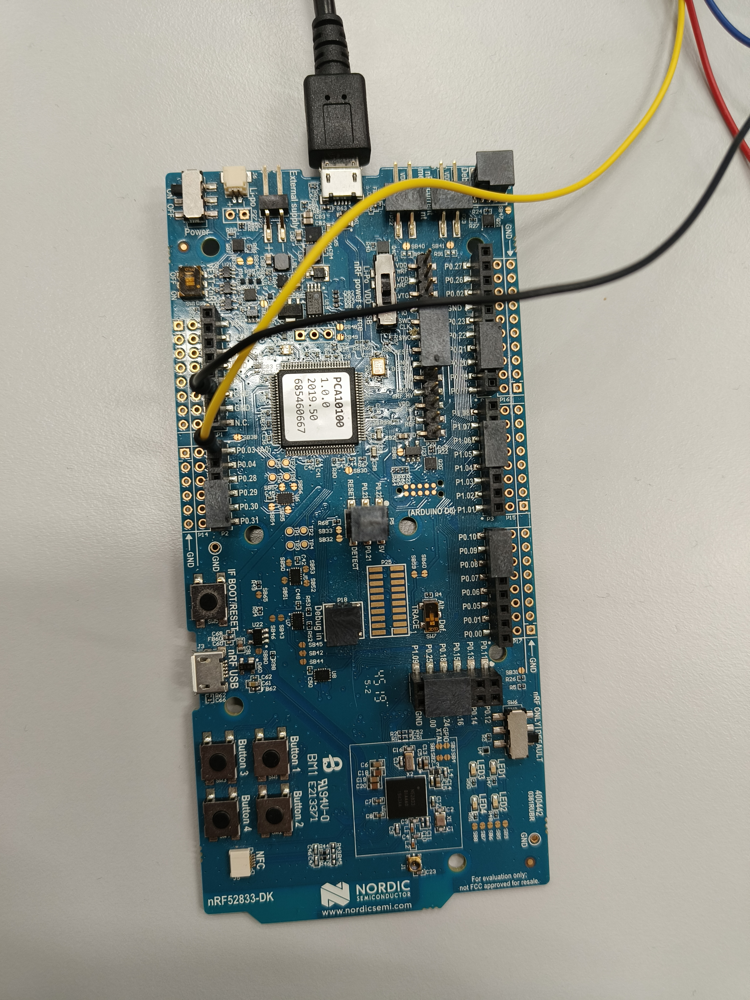
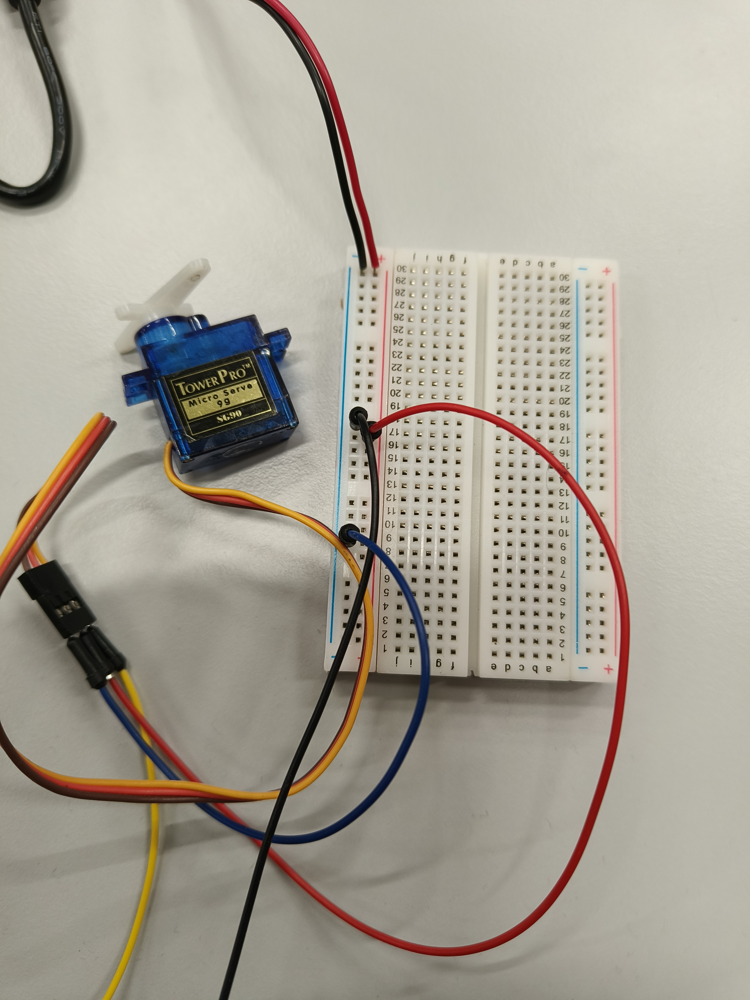
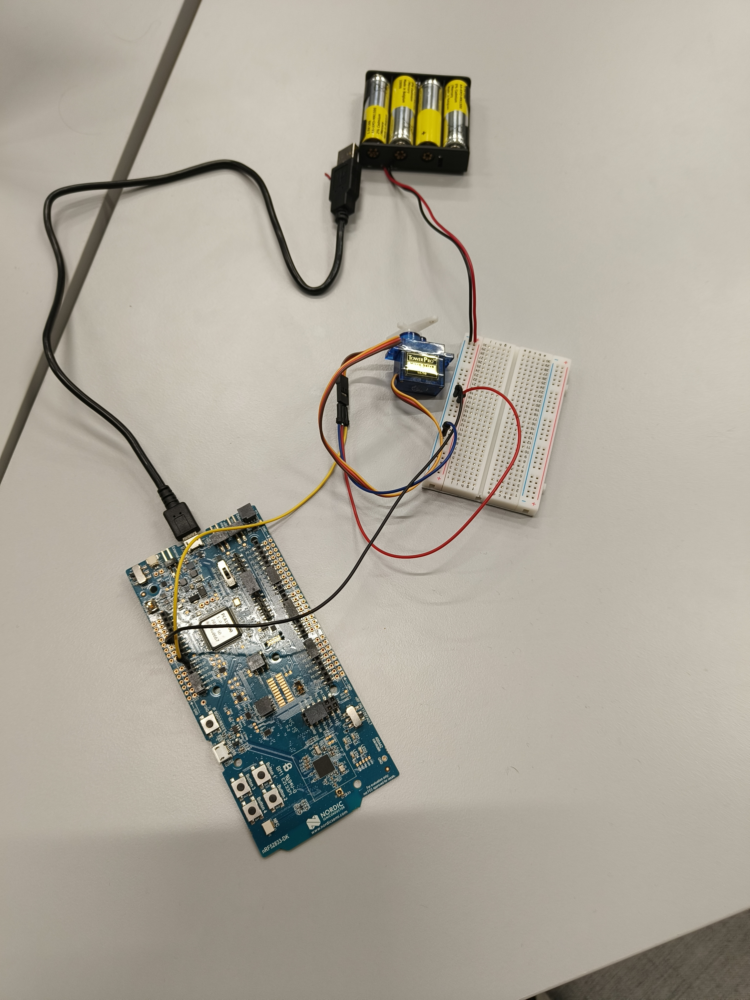

# BLE Dog Treat Dispenser 🦴

A Bluetooth-controlled dog treat dispenser built with Zephyr RTOS and the Nordic nRF52833 Development Kit. This project allows users to dispense treats remotely using a smartphone app. 

It utilizes the Nordic LED Button Service (LBS) to receive commands from your phone using the nrfconnect app.

## ✨ Features
* **Remote BLE Control:** Open and close the dispenser directly from any iOS or Android device using Bluetooth Low Energy.
* **Visual Status UI:** Uses the on-board LED (LED1) to indicate system status:
  * *Blinking:* Advertising / Waiting for connection.
  * *Solid:* Connected and ready.
  * *Quick Flash:* Command received and executed.

## 🛠️ Hardware Requirements
* **Development Board:** [Nordic nRF52833-DK](https://www.nordicsemi.com/Products/Development-hardware/nrf52833-dk)
* **Actuator:** SG90 Micro Servo Motor (or equivalent 5V hobby servo)
* **Jumper Wires:** Female-to-Female or Male-to-Female depending on your headers
* **Breadboard:** A breadboard for connecting the batterypack
* **Batterypack:** A batterypack to power the servo motor

### Wiring Guide
The SG90 servo has three wires. Connect them to the nRF52833-DK as follows:
| SG90 Wire Color | Function | nRF52833-DK Pin |
| :--- | :--- | :--- |
| **Brown / Black** | Ground (GND) | `GND` |
| **Red** | Power (5V) | Connect to the breadboard so it draws power from the battery |
| **Orange / Yellow** | PWM Signal | Pin `P0.03` in the nRF52833-DK |





## 💻 Software Prerequisites
To build and flash this project, you will need:
1. [nRF Connect SDK (NCS)](https://developer.nordicsemi.com/nRF_Connect_SDK/doc/latest/nrf/installation.html)
2. Visual Studio Code with the **nRF Connect for VS Code** extension.
3. [nRF Connect for Mobile](https://www.nordicsemi.com/Products/Development-tools/nrf-connect-for-mobile) installed on your smartphone (iOS/Android).

## 🚀 Building and Flashing

1. **Clone the repository:**
   ```bash
   git clone [https://github.com/YOUR-USERNAME/dog-treat-dispenser.git](https://github.com/teemu-simonen/dog-treat-dispenser.git)

2. **Open the project in VS Code:**
    Launch Visual Studio Code and open the dog-treat-dispenser folder. Ensure you have the nRF Connect for VS Code extension installed and active.

3. **Create a Build Configuration:**
    Click the nRF Connect icon in the left sidebar. Under the Applications view, click Add Build Configuration. Select nrf52833dk_nrf52833 as your target board and click Build Configuration. Wait for the process to output Build successful in the terminal.

4. **Flash the Board:**
    Plug your nRF52833-DK into your computer using a micro-USB cable and ensure the board's power switch is ON. Under the Actions menu in the nRF Connect sidebar, click Flash.(Verification: Once flashing is complete, LED1 on the board will immediately start blinking every 500ms to indicate it is successfully broadcasting).